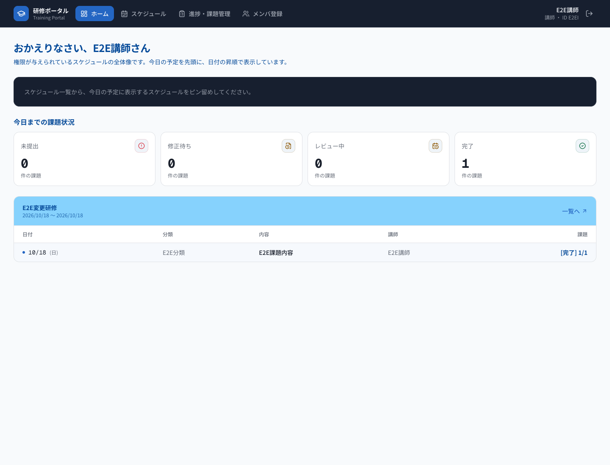
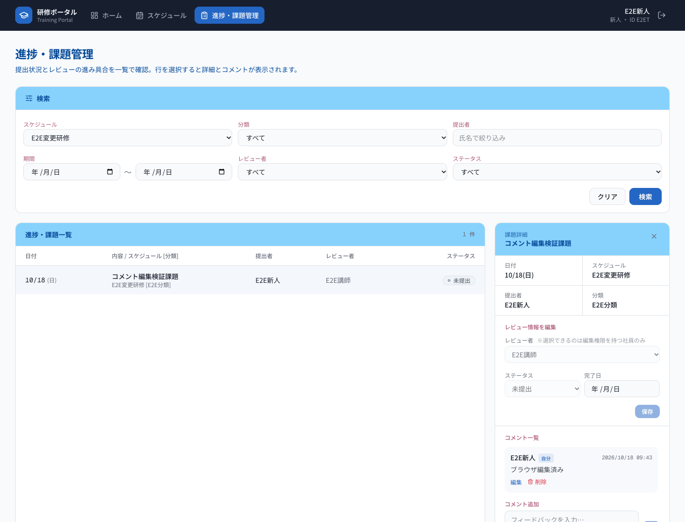

# 新人研修スケジュール・課題管理ポータル

Next.js/React/TypeScriptとSpring Boot/Java21、PostgreSQL17による研修ポータルです。ログイン、メンバー管理、スケジュール・編集権限・ピン留め、課題提出状況・レビュー・コメント、Home集計をREST APIとDBで連携します。業務画面をlocalStorageだけで動かすモックではありません。


## 開発目的と構成

新人・講師が研修予定、対象者ごとの操作権限、課題提出とレビューの状況を一か所で確認できるようにすることを目的に開発しました。画面・API・DBの設計書、実装、自動テストとブラウザE2Eの検証記録を収録しています。

```text
Next.js / React → REST JSON API → Spring Boot → PostgreSQL
                       セッション認証・CSRF     Flyway / JPA
```

| 層 | 採用技術 |
| --- | --- |
| Frontend | Next.js 16.4.1 / React 19.3.1 / TypeScript 5.7.3 |
| Backend | Spring Boot 4.1.1 / Java 21 / Spring Security / Spring Data JPA |
| Database | PostgreSQL 17 / Flyway |
| 検証 | JUnit / Vitest / 実ブラウザE2E |

バージョンの詳細は[pom.xml](pom.xml)、[package.json](frontend/package.json)、[lockファイル](frontend/pnpm-lock.yaml)を参照してください。

## 画面と主要機能

| 画面 | 実装済みの主な操作 |
| --- | --- |
| ログイン | セッション認証、ログアウト |
| Home | 新人・講師に応じた研修・課題状況の確認 |
| メンバー管理 | 講師によるメンバー登録・一覧・更新・削除 |
| スケジュール | 一覧・詳細、編集権限に応じた管理、利用者ごとの最大2件のピン留め |
| 進捗・課題 | 提出状況・レビュー・コメント、本人コメントの編集 |

既存検証で合成データを使用した画面例です。全画面・全状態の一覧ではありません。





## 認証・権限・DB設計

JSESSIONIDによるセッション認証とCSRF対策を使用します。新人は閲覧権限のあるスケジュールと自分の課題を参照し、講師は編集権限のあるスケジュールを管理します。API側でも認可し、パスワードはハッシュ化します。更新カウンタによる楽観ロックで競合を検出します。

DBパスワードは環境変数から取得し、秘密値をソースへ保存しません。業務テーブルの変更はFlywayで管理し、Hibernateは構造検証に使用します。

- [基本詳細設計書](docs/design/基本詳細設計書.xlsx)
- [テーブル定義書](docs/design/テーブル定義書.xlsx)
- [認証API](docs/api/auth.md)、[メンバーAPI](docs/api/members.md)、[スケジュールAPI](docs/api/schedules.md)、[進捗API](docs/api/progress.md)、[Home API](docs/api/home.md)

## テストの実行と改善候補

[新規環境セットアップ手順](docs/setup/fresh-environment.md)に検証方法を記載しています。フロントエンドは`frontend`で`pnpm run test`、`pnpm run typecheck`、`pnpm run lint`、`pnpm exec next build --webpack`を使用します。DBを必要とするバックエンド検証は独立した検証環境で実施し、通常開発DBへそのまま実行しないでください。

未ログイン自己登録は提供していません。全ブラウザ・全障害系・キーボード/スクリーンリーダーの操作性を網羅した検証は未完了です。改善候補はアクセシビリティ、実ブラウザでの競合・障害系検証です。過去のRC作成時の検証と、今回の公開前確認を区別します。

## 新規環境

[空DBからのセットアップ手順](docs/setup/fresh-environment.md)を最初から実施してください。

1. Java21、PostgreSQL17、Node.js24、pnpm12を準備。
2. 既存開発DBと別の専用PostgreSQL・非5432ポートに、空DBとtraining_portal_userを準備。
3. `./mvnw -DskipTests package`でJARを作成。
4. 新規構築専用`FreshDatabaseCommand`でV1〜V5を適用。
5. [初期講師コマンド](docs/setup/initial-instructor-setup.md)を実端末で実行。
6. DBパスワードを安全に環境変数へ渡し、バックエンド起動。
7. `frontend/.env.example`を参考に公開API URLを設定し、Next.jsを起動。
8. 初期講師でログインし、メンバー管理から新人・講師を登録。

publicではV3を通常実行できません。専用ランナーがV1/V2→V3省略登録→V4→V5の順に処理します。test1は別の空DBで通常適用します。通常target=2は変更しません。既存V4専用ランナーを新規構築に使わないでください。

## 構築済み環境

起動時の既定DBはlocalhost:5432/training_portalのpublicです。新規構築用専用ポートを使う場合は起動引数でDB URLを指定します。手順を確認せず既存DBへmigrationやテストを実行しないでください。

- [セットアップ・起動・トラブル対応](docs/setup/fresh-environment.md)
- [認証の接続構成](docs/implementation/frontend-auth.md)
- [API仕様書](docs/api/)
- [新規構築の検証結果](docs/verification/fresh-environment-setup-test.md)

未ログイン自己登録・固定初期パスワードは提供しません。パスワード・Cookie・トークン・DBバックアップ・個人環境の.env.localを公開しないでください。

## 検証状況と公開前の保留事項

過去のクリーン構築検証では、公開用ファイル集合から空の専用Maven/pnpmキャッシュで依存を取得し、バックエンドとNext.jsのWebpack buildを確認しています。実行条件・失敗試行・範囲は[クリーン構築検証](docs/verification/public-snapshot-validation.md)を参照してください。Java・Node.js・PostgreSQL・Chrome等のOSインストール自体が空だったという意味ではありません。

- フロントエンド：15ファイル218テスト成功、型チェック・lint成功。
- バックエンド回帰：217件中207件成功、10件スキップ、失敗・エラー0件。スキップのうち構築関連5件は別枠で成功し、残り5件も後続の隔離試験で成功しました。重複実行を含むため、これらを単純加算した総テスト件数としては扱いません。
- 実ブラウザの業務E2E：再試験後の19ケースが成功。初回4ケースの失敗、再試験、対象外の操作も[業務E2E検証](docs/verification/public-snapshot-e2e-validation.md)に記録しています。

検証では明示的なWebpack buildを使用しました。フロントエンドの該当ディレクトリで`pnpm exec next build --webpack`を実行する方法が当該検証の確認済み経路です。既定buildの別エンジン、全ブラウザ、全障害系を確認済みとするものではありません。

本リポジトリは、監査済みの公開候補から独立して構成したポートフォリオ公開用ソースです。開発用リポジトリおよび旧公開候補のGit履歴は引き継いでいません。取り込み元は既存Privateリポジトリ旧Private公開候補（非公開保管）の`e0fdb3fe27ca4356a566721e2fb9b2c33ea2f383`で、監査済み302ファイルを基礎としています。旧Privateリポジトリと3コミットの履歴はそちらに保持し、本リポジトリには含めていません。ソースの公開と実サービスの配備は別工程として扱います。テーブル定義書には、DB定義を維持して空ブックから作成した独自フォーマットを採用しました。基本詳細設計書は既存の匿名化済み版を維持しています。[設計書の確認記録](docs/verification/excel-visual-confirmation.md)に版ごとのハッシュと確認範囲を区別して記載しています。

基本詳細設計書の画像はJPEG28実体・PNG10実体です。本人が基本仕様と画面イメージを作り、AIで画面生成・設計書修正を行い、本人が撮影して設計書へ貼付した作成経緯を記録しています。JPEG28件は過去ExcelへのSHA-256一致を確認済みです。撮影直後の元ファイルは未特定ですが、今回の表示内容と元コード・既存通知の限定確認では、画像差替えを要する明確な問題は見つかっていません。既存画像を維持し、撮影原本の追加探索は行わず公開準備を進めます。[画像台帳](docs/verification/design-image-materials.md)、[過去の素材確認記録と最新追記](docs/verification/prepublication-materials-review.md)、[第三者通知](THIRD_PARTY_NOTICES.md)を参照してください。これは第三者権利の包括保証やPublic化承認ではありません。本リポジトリは、旧履歴を保持するPrivateリポジトリとは独立して、監査済み最新版のファイルだけで構成するB案に基づきます。[クリーン候補構築時の記録](docs/verification/clean-release-candidate.md)等は当時の結果として保持します。

素材確認段階の検証では、未実行だった専用テスト5件と、実Chromeによるログイン・主要4画面の最小スモーク確認が成功しました。過去の業務E2E19ケースを今回すべて再実行したという意味ではありません。全ブラウザ・全障害系・スクリーンリーダー検証は未完了です。

現在の構築手順は`docs/setup/`を使用します。過去の検証資料に登場する固定ポート、非配布ログ・バックアップ、一時スクリプト、旧V4ツールは、新規構築に必須の配布物ではありません。固定59455を前提とする一部の専用テストは、隔離と空き確認なしで実行しないでください。

## セキュリティ対策と現在の検証状況

本候補は、第1〜第3段階のセキュリティ修正と通知補完を含む取り込み元の監査済み実装を維持しています。取り込み元の過去のセキュリティ検証基準`668ab0b2e00acf82947a2393b5ac1aa27a0e815e`は295ファイル、通知補完後の取り込み元`e0fdb3fe27ca4356a566721e2fb9b2c33ea2f383`は302ファイルです。これらのSHAは取り込み元の過去の検証対象を示し、本リポジトリの祖先コミットではありません。本リポジトリは同じ302パスのファイル集合に画像確認文書等の限定修正を加えた構成です。取り込み元の旧Privateにある3コミットの履歴は公開対象に含めません。登録・公開の手順ではPrivateでの内容照合と最終監査を経て、所有者の明示承認後にのみPublic化する方針です。

基準コミットと同一295ファイルに対する直前の限定反映後の検証では、Frontend16ファイル230件、Backend251件が成功しています。Backend通常実行で条件付きスキップされた12件は独立DBの専用実行で補完し、重複を除いた件数です。先述の218件・207件・業務E2E19件は当時の結果として維持し、最新230/251件と合算しません。今回の通知・説明文書補完では業務テストや依存脆弱性監査を再実行していません。

ログイン試行制限、パスワード変更後の旧セッション失効、本番HTTPS設定ガード、画面CSP、安全な監査イベントを実装しています。実行環境はTemurin21.0.13+9・Node.js24.22.1を検証基準とし、JDKの追加CA対策はファイルコピーだけでは移行されません。[実行環境と依存更新](docs/security/stage1-runtime-upgrade.md)、[認証・セッションとHTTPS](docs/security/stage2-authentication.md)、[画面ヘッダー・監査ログと未承認のパスワード方針案](docs/security/stage3-defense-and-audit.md)を参照してください。

新しいパスワード最低文字数・漏えいパスワード拒否は未承認・未実装です。本番HTTPS・プロキシ・ログの鍵/保存/監視・負荷の運用検証は未完了で、インターネット配備の準備完了とは扱いません。

Excelは公開版を維持し、正式な改訂は未実施です。「区分変更時のみ認証世代を更新」という説明と現在のパスワード更新時の世代更新、429、HTTPS/CSP/監査の差分は[設計書と実装の説明差分](docs/security/design-implementation-differences.md)を参照してください。[過去コミットの通知条件](docs/verification/historical-distribution-notes.md)も未解決事項として区別します。取り込み元の過去の通知補完と、本リポジトリに含めた説明文書を区別しています。Privateへの登録、ソースのPublic化、Webアプリの配備は、それぞれ別の承認対象です。公開判断（2026-11-03の確認時点）：Public化は未承認で保留し、別途明示承認が必要です。

## 検証記録の対象

本候補に収録した過去の検証資料にあるリポジトリ名・main・コミットSHA・Private状態・原本反映という記述は、各資料の作成時点における取り込み元の記録です。当時の記録を本リポジトリのGit履歴や公開・配備実績として扱いません。業務コード・設計書・画像は維持し、今回の文書修正で過去のテスト件数や実施時点を書き換えていません。
